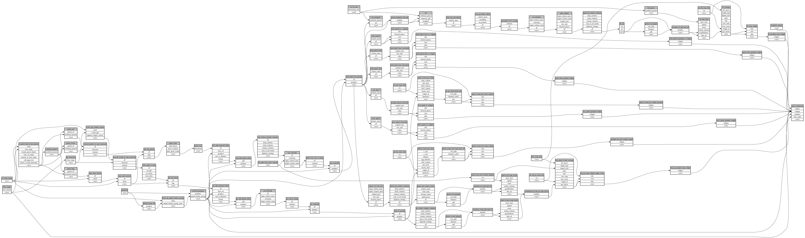

```
# AUTOGENERATED BY ECOSCOPE-WORKFLOWS; see fingerprint in README.md for details

```

```yaml
# fingerprint:
artifacts_sha256_basic: 19e237f2952c6111bad5c81326007413a9a41c3a6536dc14974a5c24a5b8cc4c
artifacts_sha256_strict: db0ece52b1e51b5eebe2c9e88cef306a776622ff197b10cc06214ee6682b28e4
installed_requirements:
- channel: conda-forge
  name: python
  version: {version: ==3.12.15}
- channel: https://repo.prefix.dev/ecoscope-workflows/
  name: lonboard
  version: {version: ==0.0.8}
- channel: conda-forge
  name: numpy
  version: {version: ==2.0.2}
- channel: conda-forge
  name: pyarrow
  version: {version: ==23.0.1}
- channel: conda-forge
  name: pydantic
  version: {version: ==2.8.2}
- channel: conda-forge
  name: rasterio
  version: {version: ==1.4.4}
- channel: conda-forge
  name: pydeck
  version: {version: ==0.9.2}
params_sha256: d6f5fafd9b4ca81cde8f9552e603259352d285e9685e31cde847b3648d74d06c
spec_sha256: 0d462d3753fb4145e96dfc041d6526a028d424c788286f0b5b0a01af80b9c036

```

# ecoscope-workflows-patrols-workflow


